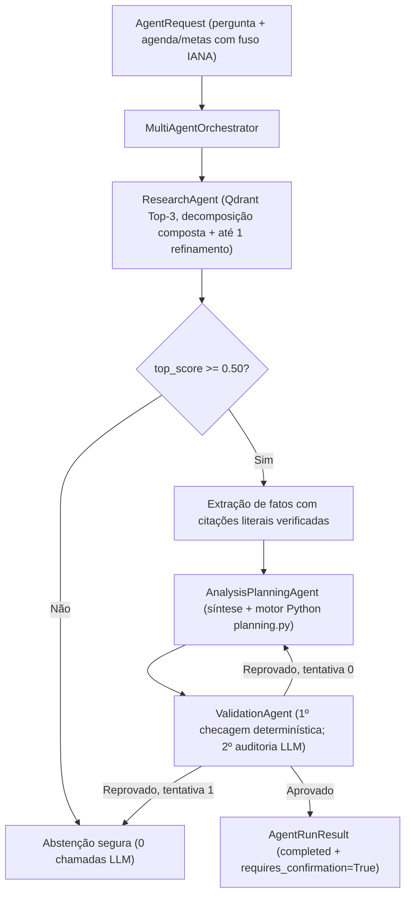

# AGENTS.md — Guia de Arquitetura, Stack e Operação do Projeto Vezo

> **Projeto:** Vezo — Assistente de Rotina e Gestão de Tempo Universitária (`assistente-rotina-academica` v0.1.0)
> **Escopo:** Assistente inteligente para universitários em multijornada (aulas, trabalho/residência, estágios, projetos e estudo autônomo). Entrega final do MVP: `11/12/2026`.
> **Branches principais:** `develop` (integração ativa) e `main` (release).
> **Documentação viva (fonte de verdade):** `docs/PRD.md` (produto), `docs/ARCHITECTURE.md` (arquitetura ponta a ponta), `docs/DESIGN.md` (UX/PWA/tokens visuais), `docs/TASKS.md` (roadmap priorizado) e `docs/MEMORY.md` (decisões e lições aprendidas).

---

## 1. Arquitetura Geral

O repositório combina três pilares já implementados no backend e uma frente de produto/observabilidade em consolidação rumo à entrega de `11/12/2026`:

1. **Pipeline de Dados & Retrieval Multimodal (`src/data_pipeline/`)**: extração de texto de PDFs (digitais e escaneados), imagens (OCR), áudios (STT) e documentos Word/TXT; fatiamento em chunks; geração de embeddings multilíngues (384d) e indexação/busca por similaridade de cosseno no **Qdrant** (evoluindo para chunking estrutural, Contextual Retrieval e reranking).
2. **Benchmark Comparativo LLM vs. RAG (`scripts/scenarios/`, `tests/benchmark_*`)**: avaliação padronizada sobre o **Golden Set oficial** (`GS-01` a `GS-12`: 11 perguntas factuais multimodais + 1 fora de domínio) validada por JSON Schema Draft 2020-12 (`contract_version: 1.0.0`).
3. **Sistema Multiagentes + Motor Determinístico de Agenda (`src/agents/`, `scripts/demo_multiagents.py`)**: orquestração determinística em Python coordenando três papéis especializados (`ResearchAgent`, `AnalysisPlanningAgent`, `ValidationAgent`) com contratos **Pydantic v2** estritos, gate pré-LLM, até 1 rodada de correção e alocação algorítmica de horários sem efeitos colaterais.
4. **Camadas do MVP em Construção (`src/api/`, `src/mlops/`, `frontend/`)**: API **FastAPI** com sessões persistentes, observabilidade via **MLflow** e **PWA responsivo** em **Next.js / React + Tailwind CSS + shadcn/ui** (dashboard Hoje/Semana/Mês, visualizador de cenário/conflitos e chat integrado; sem estética *vibe coding* e com paleta em tokens semânticos desacoplados).

### Fluxo Multiagentes



---

## 2. Mapa do Repositório

| Caminho | Responsabilidade |
| --- | --- |
| `src/data_pipeline/extractors.py` | Extração multimodal: `extrair_texto_imagem` (Tesseract `por`, `--psm 6`), `transcrever_audio` (Whisper `tiny`, `pt`, `.ogg`/`.mp3`/`.wav`), `extrair_texto_pdf` (PyMuPDF + fallback OCR 2x), `extrair_texto_word` (`python-docx`, parágrafos e tabelas). |
| `src/data_pipeline/ingestion.py` | Ingestão completa de `data/samples/`: chunking de `500` caracteres (`overlap=50`), vetorização via `paraphrase-multilingual-MiniLM-L12-v2` (384d) e recriação/upsert na coleção `rotina_estudante_multimodal` no Qdrant (`localhost:6333`, `COSINE`). IDs determinísticos via `uuid5`. |
| `src/data_pipeline/retrieval.py` | Módulo reutilizável de busca (`SearchHit`, `get_client`, `load_embedder`, `search`, `expected_rank`). Usa `client.query_points` (Top-3 padrão). Conecta via `QDRANT_URL` (se definida) ou disco local (`data/qdrant`). |
| `src/agents/schemas.py` | Contratos Pydantic v2 (`extra="forbid"`, `allow_inf_nan=False`): `AgentRequest`, `Interval`, `ScheduleSlot`, `StudyGoal`, `EvidenceChunk`, `EvidenceFact`, `ResearchNotes`, `RetrievalResult`, `Claim`, `AnalysisNotes`, `PlanningProposal`, `ProposalDraft`, `ValidationNotes`, `ValidationResult`, `TraceEvent`, `RunMetrics`, `AgentRunResult`. |
| `src/agents/llm.py` | Cliente HTTP nativo (`urllib.request`, sem SDK) para Groq (`openai/gpt-oss-20b`, saída JSON estruturada, `tool_choice="none"`, `include_reasoning=False`, pacing `min_call_interval`, contabilidade de tokens/latência) e `load_api_key` isolado. |
| `src/agents/research_agent.py` | `QdrantRetriever` (valida vetor único 384d + `COSINE`) e `ResearchAgent`: divide perguntas compostas (2 orações interrogativas), aplica gate `threshold=0.50`, verifica citações literais no chunk, permite até 1 refinamento (máx. 2 queries extras) e limita chunks finais a 3 (simples) ou 5 (composta/refinamento). |
| `src/agents/planning.py` | Motor determinístico de agenda (sem LLM, sem persistência): protege sono recorrente no fuso IANA (inclui virada de meia-noite e DST), detecta `input_conflicts` sem mover eventos fixos, aloca blocos de até 60 min ordenados por `(deadline, -priority, goal_id)`, registra `unallocated` e audita todas as invariantes em `audit_plan`. |
| `src/agents/analysis_planning_agent.py` | Gera `ProposalDraft` com afirmações vinculadas a `source_ids` (`[C1: arquivo.ext]`), chama `plan(request)` e consolida `limitations`. |
| `src/agents/validation_agent.py` | Validação em 2 níveis: estrutural/invariantes em código (citações, `render_claims`, `audit_plan`; reprova sem chamar LLM) + auditoria semântica via LLM. |
| `src/agents/orchestrator.py` | `MultiAgentOrchestrator`: executa o pipeline com no máximo 1 correção (máx. 6 chamadas LLM), sanitiza exceções (sem vazar corpo HTTP ou chaves) e produz `AgentRunResult` + trace completo. |
| `src/agents/demo.py` | 4 cenários fictícios (`documental`, `planejamento`, `fora_dominio`, `correcao`) e doubles offline (`SimulatedRetriever`, `SimulatedLLM`). |
| `src/api/`, `src/mlops/`, `src/ui/` | Pacotes reservados (`__init__.py` vazios): `src/api/` (FastAPI + sessões persistentes) e `src/mlops/` (MLflow tracking) são P0 do MVP; `src/ui/` é legado Python (a UI oficial alvo é o PWA em `frontend/`). |
| `frontend/` *(planejado)* | PWA responsivo alvo em **Next.js / React + Tailwind CSS + shadcn/ui** (Dashboard Hoje/Semana/Mês, visualizador de cenário/conflitos e chat assistente integrado). |
| `scripts/demo_multiagents.py` | CLI do sistema multiagentes (`--mode simulated\|live`, `--scenario`, `--request`, `--min-call-interval 15`, grava traces em `reports/multiagents/`). |
| `scripts/demo_retrieval.py` | Demo interativa/CLI de recuperação semântica no Qdrant (`localhost:6333`). |
| `scripts/evaluate_rag.py` | Benchmark formal de retrieval da Sprint 2 (12 queries; exporta `reports/evaluation_summary.json`). |
| `scripts/scenarios/zero_shot.py` | Cenário 1: LLM puro via Groq ou Ollama (`urllib.request`, totalmente isolado de Qdrant/RAG). |
| `scripts/scenarios/naive_rag.py` | Cenário 3: RAG Top-3 sem guardrail pré-LLM (usa SDK `groq` + `src/data_pipeline/retrieval.py`). |
| `scripts/scenarios/guardrail_rag.py` | Cenário 4: RAG Top-3 com guardrail pré-LLM (`threshold=0.50`, usa SDK `groq` + `qdrant-client`). |
| `scripts/check_whatsapp.py`, `scripts/debug_ocr_chunks.py` | Utilitários de inspeção e depuração de chunks OCR no Qdrant. |
| `data/samples/` | Base curada e anonimizada (LGPD): 25 documentos (`DOC-01` a `DOC-25` — 9 PDFs, 1 TXT, 7 imagens, 8 áudios) catalogados em `data/samples/README.md`. |
| `infra/docker-compose.yml` | Orquestração local dos serviços `qdrant` (`qdrant/qdrant:v1.12.1`, portas `6333`/`6334`) e `mlflow` (`v2.19.0`, porta `5000`). |
| `tests/` | Golden Set (`benchmark_llm_rag_queries.json`), Schema (`benchmark_result_schema.json`) e suítes `pytest` (`test_smoke.py`, `test_qdrant_smoke.py`, `test_retrieval.py`, `test_benchmark_golden_set.py`, `test_zero_shot.py`, `test_guardrail_rag.py`, `test_multiagents.py`). |
| `docs/` & `reports/` | Documentação viva (`PRD.md`, `ARCHITECTURE.md`, `DESIGN.md`, `TASKS.md`, `MEMORY.md`, além de guias de infra, pipeline, zero-shot e multiagentes); resultados JSON e evidências dos cenários 1, 3 e 4. |

### Contrato de Payload no Qdrant (`rotina_estudante_multimodal`)

- **Vetores:** vetor único denso de **384 dimensões**, distância **COSINE** (`paraphrase-multilingual-MiniLM-L12-v2`).
- **Payload por ponto:** `text`, `source`, `task_type` (`"texto" | "ocr" | "audio"`), `user_id` (`"usuario_teste"`), `created_at` (ISO 8601 UTC), `chunk_index` (int `>= 0`).

---

## 3. Stack e Dependências

### Runtime e Ferramentas de Sistema

- **Python:** `>=3.11,<3.12` (**obrigatório 3.11.x**; versões `>=3.12` têm incompatibilidades com dependências de IA).
- **Docker & Docker Compose v2:** necessários para Qdrant (`localhost:6333`) e MLflow (`localhost:5000`).
- **Tesseract OCR** (apenas para ingestão de imagens/PDFs escaneados): pacote com idioma português (`por`). No Windows, pode exigir `TESSERACT_CMD` e `TESSDATA_PREFIX`.
- **FFmpeg** (apenas para transcrição de áudio com Whisper).

### Dependências Python

- **Declaradas em `pyproject.toml`:** `pydantic>=2.6.0`, `jsonschema>=4.18.0`, `qdrant-client>=1.8.0`, `sentence-transformers>=2.5.0`, `langchain-text-splitters>=0.0.1`, `pytesseract>=0.3.10`, `Pillow>=10.2.0`, `openai-whisper>=20231117`, `fastapi>=0.110.0`, `uvicorn>=0.28.0`, `streamlit>=1.32.0`, `mlflow>=2.11.0`.
- **Declaradas em `requirements.txt` (usadas na ingestão/testes):** `PyMuPDF`, `python-docx`, `python-dotenv`, `pytesseract`, `Pillow`, `openai-whisper`, `sentence-transformers`, `qdrant-client`, `pytest`, `jsonschema>=4.18.0`.
- **Extras de desenvolvimento / CI:** `pytest>=8.0.0`, `pytest-mock`, `pytest-asyncio`, `ruff>=0.3.0`, `mypy`, `httpx>=0.27.0`.
- **Observação:** Os scripts `scripts/scenarios/naive_rag.py` e `scripts/scenarios/guardrail_rag.py` importam o SDK `groq` (`pip install groq`), que não está listado em `pyproject.toml` nem em `requirements.txt`. Já `zero_shot.py` e `src/agents/llm.py` usam apenas `urllib.request`.

### Modelos de IA e Provedores

- **Embeddings:** `sentence-transformers/paraphrase-multilingual-MiniLM-L12-v2` (384d). *(Nota: `.env.example` ainda referencia `all-MiniLM-L6-v2` de uma fase anterior; o código atual padronizou o modelo multilíngue.)*
- **LLM (Benchmark e Multiagentes):** `openai/gpt-oss-20b` via **Groq** (`temperature=0`, `seed=42`, `max_completion_tokens=2048`, `reasoning_effort="low"`, `include_reasoning=False`). `zero_shot.py` também suporta **Ollama** local (`POST /api/chat`).
- **STT / OCR:** `whisper` (`tiny`, `language="pt"`) e `tesseract` (`lang="por"`, `--psm 6`).

### Variáveis de Ambiente Principais

- `GROQ_API_KEY`: chave Groq (apenas em `.env` local ou ambiente; **nunca versionar**).
- `QDRANT_URL` / `QDRANT_API_KEY`: URL do servidor Qdrant (ex.: `http://localhost:6333`) e chave opcional.
- `QDRANT_PATH` / `QDRANT_COLLECTION`: caminho local (padrão `data/qdrant`) e coleção (padrão `rotina_estudante_multimodal`).
- `TESSERACT_CMD` / `TESSDATA_PREFIX`: caminhos do Tesseract OCR no Windows.
- `ZERO_SHOT_MODEL` / `OLLAMA_HOST`: configuração opcional do Cenário 1 com Ollama.
- `MLFLOW_TRACKING_URI`: servidor MLflow (`http://localhost:5000`).

---

## 4. Comandos Principais

### Setup do Ambiente Local

```powershell
# Windows (PowerShell)
py -3.11 -m venv .venv
.\.venv\Scripts\Activate.ps1
python -m pip install -r requirements.txt
# Para multiagentes e ferramentas de dev:
python -m pip install "pydantic>=2.6.0" ruff mypy pytest-mock pytest-asyncio
```

```bash
# Linux / macOS
python3.11 -m venv .venv
source .venv/bin/activate
python -m pip install -r requirements.txt
```

### Infraestrutura (Docker Compose)

```bash
# Subir apenas Qdrant (http://localhost:6333)
docker compose -f infra/docker-compose.yml up -d qdrant

# Subir Qdrant + MLflow (http://localhost:5000)
docker compose -f infra/docker-compose.yml up -d
```

### Ingestão e Retrieval

```bash
# Popular/recriar coleção rotina_estudante_multimodal no Qdrant (Docker localhost:6333)
python -m src.data_pipeline.ingestion

# Demo interativa ou com pergunta direta
python scripts/demo_retrieval.py "Quando é a aula de Econometria?"

# Avaliação formal de retrieval (Sprint 2 -> reports/evaluation_summary.json)
python scripts/evaluate_rag.py
```

### Sistema Multiagentes

```bash
# 4 cenários simulados (sem Qdrant, embeddings ou rede)
python scripts/demo_multiagents.py

# Modo live com Qdrant local em disco
python scripts/demo_multiagents.py --mode live --env-file .env --qdrant-path data/qdrant --output-dir reports/multiagents

# Modo live com Qdrant Docker (defina QDRANT_URL=http://localhost:6333 e omita --qdrant-path)
python scripts/demo_multiagents.py --mode live --env-file .env --scenario documental

# Pedido customizado via JSON (conforme AgentRequest)
python scripts/demo_multiagents.py --mode live --env-file .env --request request.json
```

### Benchmark Comparativo (Sprint 3)

```bash
# Cenário 1 — Zero-Shot (Groq)
python scripts/scenarios/zero_shot.py --provider groq --env-file .env \
  --model openai/gpt-oss-20b --temperature 0 --seed 42 \
  --max-tokens 2048 --reasoning-effort low --timeout 120

# Cenário 3 — Naive RAG (requer groq SDK, GROQ_API_KEY e QDRANT_URL=http://localhost:6333 ou data/qdrant)
python scripts/scenarios/naive_rag.py

# Cenário 4 — Guardrail RAG (requer groq SDK, GROQ_API_KEY e Qdrant em QDRANT_URL)
python scripts/scenarios/guardrail_rag.py
```

### Qualidade, Tipagem e Testes (Paridade com CI)

```bash
# Lint e formatação (Ruff: line-length=88, target py311, regras E/F/I/B/UP, ignora E501)
ruff check .
ruff format --check .

# Checagem estática de tipos
mypy src --ignore-missing-imports --no-warn-return-any

# Suíte leve executada no CI (sem Docker, Qdrant ou rede)
pytest tests/test_smoke.py tests/test_benchmark_golden_set.py tests/test_zero_shot.py tests/test_multiagents.py -v

# Suíte completa local (inclui test_retrieval.py, test_guardrail_rag.py e test_qdrant_smoke.py)
pytest -v
```

---

## 5. Diretrizes e Guardrails Obrigatórios para Agentes

1. **Conformidade com CI e Guardrails LGPD (`.github/workflows/ci.yml`)**:
   - **Nunca** adicionar arquivos de pesos de modelo (`.bin`, `.pt`, `.pth`, `.gguf`, `.safetensors`, `.onnx`) em qualquer diretório.
   - **Nunca** adicionar mídias/PDFs/arquivos compactados (`.tar.gz`, `.zip`, `.wav`, `.mp3`, `.m4a`, `.pdf`) ou arquivos acima de `10 MB` fora de `data/samples/`.
   - **Nunca** versionar `.env`, credenciais (`GROQ_API_KEY`) ou traces em `reports/multiagents/` (ignorados no `.gitignore`).
2. **Isolamento de Gabarito e Contratos**:
   - Scripts de benchmark devem ler apenas `query_id` e `question` de `tests/benchmark_llm_rag_queries.json`; nunca enviar `expected_answer`, `key_facts` ou `evidence` ao LLM.
   - Não quebrar `tests/benchmark_result_schema.json` (`contract_version: 1.0.0`) nem os contratos Pydantic de `src/agents/schemas.py`.
   - Em `scripts/scenarios/zero_shot.py`, manter isolamento total (não importar `qdrant_client` nem `src.data_pipeline`).
3. **Segurança e Determinismo no Sistema Multiagentes**:
   - Manter prompts tratando documentos, perguntas e pareceres como dados não confiáveis e sempre usar `tool_choice="none"`.
   - Nunca gravar corpo HTTP bruto ou credenciais em traces/erros.
   - Nunca alterar a agenda do usuário automaticamente (`requires_confirmation=True`); toda validação de horizonte, sono, prazo e conflito deve passar por `src/agents/planning.py`.
4. **Atenção ao Modo do Qdrant (Docker vs. Disco Local)**:
   - `ingestion.py`, `demo_retrieval.py`, `evaluate_rag.py` e `guardrail_rag.py` usam Qdrant HTTP (`localhost:6333` / `QDRANT_URL`).
   - `src/data_pipeline/retrieval.py` (usado por `naive_rag.py` e `QdrantRetriever`) usa `QDRANT_URL` quando definido e cai para `data/qdrant` caso contrário (modo local aceita apenas 1 processo simultâneo). Defina `QDRANT_URL=http://localhost:6333` ao trabalhar com o Qdrant Docker.
5. **Verificação antes de concluir mudanças**:
   - Sempre rodar `ruff check .`, `ruff format --check .`, `mypy src --ignore-missing-imports --no-warn-return-any` e a suíte `pytest` relevante antes de finalizar alterações em código Python.
6. **Alinhamento com Memória Técnica e Design do PWA**:
   - Consultar `docs/MEMORY.md` antes de alterar embeddings, chunking, limites de tokens (`2048`) ou pacing Groq (`15s`).
   - No frontend PWA (`frontend/`), seguir `docs/DESIGN.md`: usar **Tailwind + shadcn/ui** com **tokens semânticos CSS** (paleta oficial ainda em definição pela equipe) e evitar estética genérica de *vibe coding* (gradientes roxo-para-azul, bolhas decorativas).
