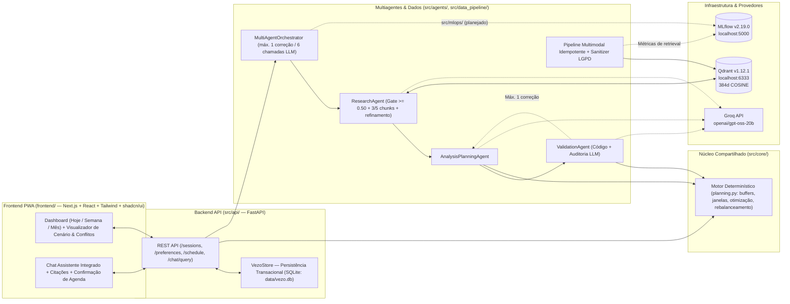

# ARCHITECTURE — Arquitetura Técnica do Projeto Vezo

> **Versão:** 2.0 (Núcleo Técnico Completo: RAG Idempotente/LGPD + Multiagentes + Motor Determinístico `src/core/` + API FastAPI/SQLite `src/api/`)
> **Guia didático para a equipe:** consulte [`docs/guia_arquitetura_vezo.md`](guia_arquitetura_vezo.md) para explicações passo a passo, persistência poliglota e exemplos práticos de integração.
> **Runtime Backend:** Python `3.11.x` (`>=3.11,<3.12`)
> **Frontend Alvo:** PWA em Next.js / React + Tailwind CSS + shadcn/ui
> **Infraestrutura Local:** Docker Compose (Qdrant `v1.12.1` + MLflow `v2.19.0`)

---

## 1. Visão Arquitetural Ponta a Ponta

---

## 2. Estado Atual vs. Arquitetura-Alvo

| Camada | Diretório | Estado Atual | Próxima Evolução (MVP `11/12`) |
| :--- | :--- | :--- | :--- |
| **Pipeline de Dados & Retrieval** | `src/data_pipeline/` | **Implementado v2** (`extractors.py`, `sanitizer.py`, `ingestion.py` idempotente, `retrieval.py`) | Chunking estrutural + Contextual Retrieval + Reranking (Top-10 → Top-3) |
| **Motor Determinístico Compartilhado** | `src/core/` | **Implementado** (`schemas.py`, `planning.py`: buffers globais/por slot, `free_windows`, `plan`, `rebalance` com diff, `audit_plan`, `audit_rebalance`) | Exposição visual de diffs/janelas no PWA e exportação `.ics` (se priorizada) |
| **Sistema Multiagentes** | `src/agents/` | **Implementado v1.1** (`schemas`, `llm`, `research`, `analysis`, `validation`, `orchestrator`, `demo`, fachada `planning.py`; validado ao vivo com 5 chunks) | Instrumentação MLflow por execução |
| **Backend API & Sessões** | `src/api/` | **Implementado** (`main.py`, `storage.py`, `dependencies.py`, `schemas.py` — FastAPI + SQLite + sessões `HttpOnly`/`X-Session-Token` + confirmação transacional) | Integração ao Docker Compose (`TASK-F5-02`), streaming SSE opcional e ingestão incremental |
| **Benchmark LLM vs. RAG** | `scripts/scenarios/`, `tests/benchmark_*` | **Implementado** (Golden Set v1.0.0, Schema v1.0.0, Cenários 1, 3 e 4) | Reexecução comparativa após chunking estrutural |
| **Observabilidade MLOps** | `src/mlops/` | **Reservado** (`__init__.py` vazio; Docker MLflow pronto) | Tracker MLflow para retrieval, benchmark e execuções multiagentes |
| **Frontend PWA** | `frontend/` *(novo)* | **Pronto para plugar** (`src/ui/` legado vazio) | PWA Next.js/React + Tailwind + shadcn/ui consumindo `src/api/` |
| **Infraestrutura Local** | `infra/` | **Implementado** (`docker-compose.yml`: Qdrant + MLflow) | Adicionar serviço FastAPI + script de bootstrap (`TASK-F5-02`) |

---

## 3. Camada de Dados, Sanitização LGPD e Retrieval (`src/data_pipeline/`)

### 3.1. Extração Multimodal com Localizadores (`extractors.py`)

- **Imagens (`.png`, `.jpg`, `.jpeg`):** `extrair_texto_imagem` via Tesseract OCR (`lang="por"`, `--psm 6`, `Pillow`, localizador `"imagem"`).
- **Áudio (`.ogg`, `.mp3`, `.wav`):** `transcrever_audio_com_tempos` / `transcrever_audio` via `openai-whisper` (`tiny`, `language="pt"`, `fp16=False`, cache `@lru_cache(maxsize=1)`), preservando faixas `"MM:SS-MM:SS"`.
- **PDF (`.pdf`):** `extrair_paginas_pdf` / `extrair_texto_pdf` via `PyMuPDF` com fallback automático para renderização 2x + Tesseract OCR por página, preservando `"p. N"`.
- **Word (`.docx`) e Texto (`.txt`):** `extrair_texto_word` (`python-docx`, parágrafos + tabelas com separador `|`) e leitura UTF-8 com BOM (`utf-8-sig`, localizador `"documento"`).

### 3.2. Sanitização PII e Segregação de Corpus (`sanitizer.py`)

- `mask_pii` aplica mascaramento determinístico de nome acompanhado de matrícula/RA/RGA, matrícula/RA/RGA, CPF, e-mail e telefone brasileiro antes da vetorização, preservando regras, datas, horários e valores acadêmicos.
- `validate_corpus_segregation` impede (`PermissionError`) a indexação de `corpus_scope="private"` ou arquivos sob diretórios privados na coleção institucional compartilhada.

### 3.3. Ingestão Batch Idempotente e Contrato Vetorial (`ingestion.py`, `retrieval.py`)

- **Coleção Qdrant:** `rotina_estudante_multimodal` (`INGESTION_VERSION = "2.0.0"`).
- **Modelo de Embeddings:** `sentence-transformers/paraphrase-multilingual-MiniLM-L12-v2` (**384 dimensões**, distância **COSINE**, execução em CPU).
- **Idempotência:** IDs determinísticos via `uuid5(NAMESPACE_URL, f"{user_id}:{source}:{chunk_index}")`, deduplicação intra-batch, skip por `file_hash` + `ingestion_version` (sem recriar a coleção por padrão; `--recreate` opcional) e limpeza de chunks órfãos quando um arquivo é reduzido.
- **Payload por ponto (6 obrigatórios preservados + 8 metadados de citação/auditoria):**
  - Base: `text`, `source`, `task_type` (`"texto" | "ocr" | "audio"`), `user_id`, `created_at` (ISO 8601 UTC), `chunk_index` (`int >= 0`).
  - Padronizados (`TASK-F2-02` / `TASK-F2-03`): `source_id`, `title`, `page_or_time`, `content_hash` (SHA-256), `file_hash` (SHA-256), `corpus_scope`, `ingestion_version`, `quality_warning`.
- **Qdrant HTTP vs. Disco Local:** `retrieval.py` usa `QDRANT_URL` quando definida (ex.: `http://localhost:6333`) e cai para `data/qdrant` (processo único) caso contrário.

---

## 4. Núcleo Determinístico Compartilhado (`src/core/`) e Multiagentes (`src/agents/`)

### 4.1. Motor Determinístico Compartilhado (`src/core/schemas.py`, `src/core/planning.py`)

Desacoplado de `src/agents/` para ser consumido diretamente pelos agentes e pela API FastAPI (com `src/agents/planning.py` e `src/agents/schemas.py` reexportando os contratos de forma 100% retrocompatível):

- **Contratos (`extra="forbid"`, `allow_inf_nan=False`):** `Interval`, `ScheduleSlot` (suporta `slot_id`, `fixed`, `buffer_before_minutes`, `buffer_after_minutes`), `StudyGoal`, `ProposedBlock`, `Unallocated`, `PlanningRequest`, `PlanningProposal` (`requires_confirmation: Literal[True] = True`), `MovedBlock`, `ScheduleDiff`, `RebalanceRequest` e `RebalanceProposal`.
- **Proteção de sono e buffers:** `expand_sleep_slots` no fuso IANA (virada de meia-noite e DST), `buffer_minutes` global (padrão `0`) + buffers por slot (`max(global, slot)`), limites `min_block_minutes` / `max_block_minutes` e detector público `free_windows(...)`.
- **Otimização (`plan`) e Rebalanceamento (`rebalance`):**
  - `plan(request)` aloca blocos ordenados por `(deadline, -priority, goal_id)`, detecta `input_conflicts` sem mover fixos e contabiliza `unallocated`.
  - `rebalance(request)` aplica **mínima perturbação** diante de imprevistos (`disruptions`): preserva blocos flexíveis não afetados em `diff.kept`, nunca move compromissos fixos ou sono, devolve `diff` (`added`, `removed`, `moved`, `kept`), `reasons`, `unallocated` e `requires_confirmation=True`.
- **Auditoria em código:** `audit_plan` e `audit_rebalance` verificam todas as invariantes (sono, fixos, buffers, horizonte, prazos, sobreposição, consistência do diff e contabilidade exata de minutos).

### 4.2. Agentes e Orquestração (`src/agents/`)

1. **`ResearchAgent` (`research_agent.py`):** valida coleção 384d `COSINE`, decompõe perguntas compostas, aplica gate pré-LLM (`threshold=0.50`, `0` chamadas LLM abaixo do limiar), verifica citações literais no trecho, permite até 1 refinamento (máx. 2 queries extras) e mantém orçamento final de **3 chunks** (simples) ou **5 chunks** (composta/refinamento — validado ao vivo recuperando frequência mínima de 90% e 3 advertências com `gaps: []`).
2. **`AnalysisPlanningAgent` (`analysis_planning_agent.py`):** sintetiza `Claim`s vinculados a `source_ids` renderizados deterministicamente (`render_claims`) e aciona `src.core.planning.plan`.
3. **`ValidationAgent` (`validation_agent.py`):** Camada 1 determinística (citações, `render_claims`, `audit_plan`; reprova sem chamar LLM) + Camada 2 semântica via LLM.
4. **`MultiAgentOrchestrator` (`orchestrator.py`) + `GroqLLM` (`llm.py`):** executa `research → analysis → validation` com máx. 1 correção (limite de 6 chamadas LLM), cliente `urllib.request` puro (`openai/gpt-oss-20b`, `temperature=0`, `seed=42`, `max_completion_tokens=2048`, `tool_choice="none"`), pacing configurável e sanitização estrita de exceções.

---

## 5. Camada de API FastAPI e Persistência SQLite (`src/api/`)

Implementada com **FastAPI + Pydantic v2 + SQLite transacional** (`VezoStore`, caminho padrão `data/vezo.db`, ignorado pelo Git e inicializado de forma lazy).

### 5.1. Persistência Poliglota & Sessões Seguras (`storage.py`, `dependencies.py`)

- **Tabelas SQLite:** `sessions` (com `token_hash` SHA-256, `schedule_version` para controle otimista de concorrência, preferências de fuso/sono/buffers e consentimento LGPD), `schedule_items` (`fixed` vs. blocos flexíveis `study`), `proposals` (`pending`/`confirmed`/`rejected` com `base_version`) e `chat_messages`.
- **Autenticação de sessão MVP:** `POST /sessions` gera token aleatório (`secrets.token_urlsafe(32)`), persiste apenas o hash SHA-256, emite cookie `vezo_session` (`HttpOnly`, `SameSite=Lax`) e aceita fallback opcional via header `X-Session-Token` (Swagger/PWA). Titularidade validada exclusivamente pelo token da sessão (sem `session_id` manipulável na URL).

### 5.2. Contrato Oficial de Endpoints (`src/api/main.py`)

- `GET /health` — status da API, conectividade SQLite, configuração Qdrant/LLM.
- `POST /sessions` / `GET /sessions/me` — criação e consulta da sessão autenticada.
- `GET /preferences` / `PUT /preferences` / `PATCH /preferences` — fuso IANA, sono (`sleep_start`/`sleep_end`), buffers, limites de bloco e consentimento.
- `GET /schedule` — agenda persistida, `schedule_version`, `input_conflicts` e `free_windows` reais (quando `horizon_start` e `horizon_end` forem informados).
- `POST /schedule` / `PATCH /schedule/{item_id}` / `DELETE /schedule/{item_id}` — CRUD com validação de timezone explícito e bloqueio (`409 Conflict`) contra invasão de sono protegido ou edição/remoção direta de compromissos fixos (`fixed=True`).
- `POST /schedule/optimize` — executa `src.core.planning.plan` + `audit_plan`, salva proposta `pending` com `base_version` e `requires_confirmation=True` sem alterar a agenda.
- `POST /schedule/reallocate` — executa `src.core.planning.rebalance` + `audit_rebalance` sobre os blocos flexíveis do horizonte e salva proposta `pending` com diff explícito e `requires_confirmation=True`.
- `POST /schedule/proposals/{proposal_id}/confirm` — valida titularidade, status `pending`, reaudita invariantes, verifica `base_version == schedule_version` (`409 Conflict` se defasada) e aplica os blocos flexíveis em transação atômica SQLite preservando sono e fixos.
- `POST /schedule/proposals/{proposal_id}/reject` — rejeita proposta preservando a agenda intacta.
- `POST /chat/query` / `GET /chat/history` — executa `MultiAgentOrchestrator` de forma assíncrona (`run_in_threadpool`), devolve resposta, `abstained`, `citations` tipadas, `limitations`/`gaps`, cria proposta pendente (`proposal_id`) quando houver planejamento e retorna `503` sanitizado em indisponibilidade de Qdrant/Groq (sem inventar resposta).

---

## 6. Camada de Frontend PWA (`frontend/` — Arquitetura-Alvo)

- **Stack:** Next.js (App Router) + React + TypeScript + Tailwind CSS + shadcn/ui.
- **PWA:** `manifest.webmanifest`, ícones e comportamento responsivo instalável em dispositivos móveis.
- **Integração:** cliente HTTP tipado apontando para `NEXT_PUBLIC_API_URL` (FastAPI, `credentials: "include"` ou `X-Session-Token`), consumindo os contratos OpenAPI de `/sessions`, `/preferences`, `/schedule`, `/schedule/optimize`, `/schedule/reallocate`, `/schedule/proposals/{id}/confirm|reject` e `/chat/query`.
- **Nota sobre `src/ui/`:** o pacote `src/ui/` (e `streamlit` no `pyproject.toml`) permanece legado/reservado; a interface oficial do produto será o PWA em `frontend/`.

---

## 7. Observabilidade, Benchmark e Infraestrutura

- **MLflow (`infra/docker-compose.yml` → `http://localhost:5000`):** backend SQLite + artifacts em volume Docker `routine_mlflow_data`. A camada `src/mlops/` registrará parâmetros (`embedding_model`, `chunk_size`, `threshold`, `llm_model`, `top_k`), métricas (`hit_at_3`, `mrr`, `latency_ms`, `rate_limit_wait_ms`, `input_tokens`, `output_tokens`, `abstention_rate`) e artefatos sanitizados.
- **Benchmark Comparativo (`tests/benchmark_*`, `scripts/scenarios/`):** Golden Set oficial (`GS-01`–`GS-12`, v1.0.0) e JSON Schema Draft 2020-12 (`contract_version: 1.0.0`). `zero_shot.py` permanece 100% isolado de Qdrant/RAG.
- **CI/CD (`.github/workflows/ci.yml`):** esteira modular com 5 matrizes e gates (`Backend Approved` incluindo `test_planning_core.py` e auto-ativação de `test_api.py`, `MLOps Approved`, `Infra Approved` com guardrails LGPD/binários/`.db`, `Frontend Approved` auto-ativável e `Runtime Approved`), consolidados no gate obrigatório `ci-verde`.
