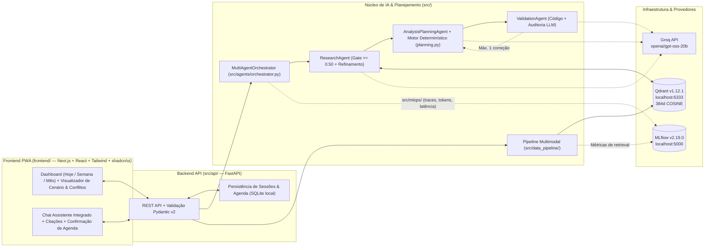

# ARCHITECTURE — Arquitetura Técnica do Projeto Vezo

> **Versão:** 1.0 (Consolidada na branch `chore/agent-setup-and-ci`)
> **Runtime Backend:** Python `3.11.x` (`>=3.11,<3.12`)
> **Frontend Alvo:** PWA em Next.js / React + Tailwind CSS + shadcn/ui
> **Infraestrutura Local:** Docker Compose (Qdrant `v1.12.1` + MLflow `v2.19.0`)

---

## 1. Visão Arquitetural Ponta a Ponta

---

## 2. Estado Atual vs. Arquitetura-Alvo

| Camada | Diretório | Estado Atual | Próxima Evolução (MVP `11/12`) |
| :--- | :--- | :--- | :--- |
| **Pipeline de Dados & Retrieval** | `src/data_pipeline/` | **Implementado** (`extractors.py`, `ingestion.py`, `retrieval.py`) | Chunking estrutural + Contextual Retrieval + Reranking (Top-10 → Top-3) |
| **Sistema Multiagentes & Agenda** | `src/agents/` | **Implementado v1** (`schemas`, `llm`, `research`, `planning`, `analysis`, `validation`, `orchestrator`, `demo`) | Exposição via FastAPI, integração com sessões e rastreamento MLflow |
| **Benchmark LLM vs. RAG** | `scripts/scenarios/`, `tests/benchmark_*` | **Implementado** (Golden Set v1.0.0, Schema v1.0.0, Cenários 1, 3 e 4) | Reexecução Cenário 2 + consolidação comparativa (`TASK-S3-05`) |
| **Backend API & Sessões** | `src/api/` | **Reservado** (`__init__.py` vazio) | FastAPI + endpoints REST + persistência de sessões/agenda (SQLite) |
| **Observabilidade MLOps** | `src/mlops/` | **Reservado** (`__init__.py` vazio; Docker MLflow pronto) | Tracker MLflow para retrieval, benchmark e execuções multiagentes |
| **Frontend PWA** | `frontend/` *(novo)* | **Em consolidação** (`src/ui/` legado vazio) | PWA Next.js/React + Tailwind + shadcn/ui (Dashboard + Chat + Conflitos) |
| **Infraestrutura Local** | `infra/` | **Implementado** (`docker-compose.yml`: Qdrant + MLflow) | Manter compatibilidade e adicionar serviço/script de dev para API + PWA |

---

## 3. Camada de Dados e Retrieval (`src/data_pipeline/`)

### 3.1. Extração Multimodal (`extractors.py`)

- **Imagens (`.png`, `.jpg`, `.jpeg`):** `extrair_texto_imagem` via Tesseract OCR (`lang="por"`, `--psm 6`, `Pillow`).
- **Áudio (`.ogg`, `.mp3`, `.wav`):** `transcrever_audio` via `openai-whisper` (`tiny`, `language="pt"`, `fp16=False`, modelo em cache `@lru_cache(maxsize=1)`).
- **PDF (`.pdf`):** `extrair_texto_pdf` via `PyMuPDF` (`pymupdf`) com fallback automático para renderização 2x + Tesseract OCR em páginas sem camada textual.
- **Word (`.docx`) e Texto (`.txt`):** `extrair_texto_word` (`python-docx`, parágrafos + tabelas com separador `|`) e leitura UTF-8 com BOM (`utf-8-sig`).

### 3.2. Ingestão e Contrato Vetorial (`ingestion.py`, `retrieval.py`)

- **Coleção Qdrant:** `rotina_estudante_multimodal`
- **Modelo de Embeddings:** `sentence-transformers/paraphrase-multilingual-MiniLM-L12-v2` (**384 dimensões**, distância **COSINE**, execução em CPU).
- **IDs de ponto:** determinísticos via `uuid5(NAMESPACE_URL, f"{user_id}:{source}:{chunk_index}")`.
- **Payload obrigatório por ponto:**
  - `text` (str): trecho do documento
  - `source` (str): caminho/origem do arquivo
  - `task_type` (`"texto" | "ocr" | "audio"`)
  - `user_id` (str, padrão `"usuario_teste"`)
  - `created_at` (str, ISO 8601 UTC)
  - `chunk_index` (int `>= 0`)
- **Atenção operacional (Qdrant HTTP vs. Disco Local):**
  - `ingestion.py`, `demo_retrieval.py`, `evaluate_rag.py` e `guardrail_rag.py` conectam via HTTP (`localhost:6333` / `QDRANT_URL`).
  - `retrieval.py` (usado por `naive_rag.py` e `QdrantRetriever`) usa `QDRANT_URL` quando definida e cai para disco local (`data/qdrant`, processo único) caso contrário. **Em desenvolvimento com Docker, defina `QDRANT_URL=http://localhost:6333`.**
- **Evolução planejada de retrieval:** substituir chunking fixo (`500` chars / `50` overlap) por **chunking estrutural** (delimitadores por perfil em `perfis_rotina_forms.txt`, tabelas e cláusulas inteiras), **Contextual Retrieval** (prefixo com documento/seção no chunk) e **Reranking** em 2 etapas (Top-10 → Cross-Encoder Top-3).

---

## 4. Sistema Multiagentes e Motor Determinístico (`src/agents/`)

### 4.1. Contratos (`schemas.py`)

Todos os modelos herdam de `Contract(BaseModel)` com `ConfigDict(extra="forbid", allow_inf_nan=False)`, mantendo independência total do schema do benchmark da Sprint 3:

- **Entrada:** `AgentRequest` (`run_id` sanitizado contra path traversal, `question`, `timezone` IANA obrigatório, `schedule_slots`, `study_goals`, `horizon` ≤ 14 dias, `sleep_start`/`sleep_end` padrão `22:00`–`06:00`).
- **Intermediários:** `RetrievalResult`, `ProposalDraft`, `PlanningProposal` (`requires_confirmation: Literal[True] = True`), `ValidationResult`.
- **Saída:** `AgentRunResult` (`contract_version="1.0.0"`, `status: "completed" | "abstained" | "error"`, `mode: "live" | "simulated"`, `trace: list[TraceEvent]`, `metrics: RunMetrics`, `error` sanitizado).

### 4.2. Agentes e Invariantes

1. **`ResearchAgent` (`research_agent.py`):**
   - Valida coleção Qdrant (vetor único, 384d, `COSINE`).
   - Decompõe perguntas compostas com duas orações interrogativas; aplica **gate pré-LLM (`threshold=0.50`)** — se `top_score < 0.50` ou vazio, abstém com `0` chamadas LLM.
   - Verifica literalmente cada `quote` no texto do chunk (`normalize(quote) in normalize(chunk.text)`), descartando citações fabricadas.
   - Permite até **1 rodada de refinamento** (máx. 2 `additional_queries`); budget final de **3 chunks** (busca simples) ou **5 chunks** (composta/refinamento).
2. **`AnalysisPlanningAgent` + `planning.py`:**
   - Gera `Claim`s vinculados a `source_ids` existentes e renderizados deterministicamente via `render_claims` (`[C1: arquivo.ext]`).
   - Aciona `plan(request)` em Python puro: expande sono recorrente no fuso IANA (cobrindo virada de meia-noite e horário de verão), detecta `input_conflicts` sem mover eventos fixos, aloca blocos de até 60 min ordenados por `(deadline, -priority, goal_id)` e registra `unallocated`.
3. **`ValidationAgent` (`validation_agent.py`):**
   - **Camada 1 (Determinística — sem LLM):** checa presença de `claims`, existência de `source_ids`, igualdade exata com `render_claims` e `audit_plan(request, proposal.planning)`. Qualquer violação reprova imediatamente sem chamar o LLM.
   - **Camada 2 (Semântica — LLM):** audita afirmações e `limitations` contra os trechos originais.
4. **`MultiAgentOrchestrator` (`orchestrator.py`) + `GroqLLM` (`llm.py`):**
   - Orquestra `research → analysis → validation` com **no máximo 1 correção** (limite absoluto de **6 chamadas LLM**).
   - Cliente HTTP nativo (`urllib.request`, sem SDK externo) para `https://api.groq.com/openai/v1/chat/completions` (`openai/gpt-oss-20b`, `temperature=0`, `seed=42`, `max_completion_tokens=2048`, `reasoning_effort="low"`, `include_reasoning=False`, `tool_choice="none"`, `response_format={"type": "json_object"}`, pacing configurável via `min_call_interval`).
   - Sanitiza exceções: jamais serializa corpo HTTP, headers ou `GROQ_API_KEY`.

---

## 5. Camada de API FastAPI e Sessões (`src/api/` — Arquitetura-Alvo)

- **Framework:** FastAPI + Uvicorn + Pydantic v2 (reaproveitando diretamente `src/agents/schemas.py`).
- **Endpoints planejados:**
  - `GET /health` — status da API, conectividade com Qdrant e estado do modelo de embeddings.
  - `POST /api/v1/sessions` / `GET /api/v1/sessions` / `GET /api/v1/sessions/{session_id}` — criação e recuperação de sessões persistentes (histórico de mensagens, agenda do estudante e preferências de sono/fuso).
  - `POST /api/v1/sessions/{session_id}/chat` — executa `MultiAgentOrchestrator` sobre a pergunta e o estado atual da agenda, retornando `AgentRunResult` (citações, lacunas, `input_conflicts` e `PlanningProposal` pendente).
  - `POST /api/v1/sessions/{session_id}/schedule/confirm` — aplica explicitamente os `proposed_blocks` somente após confirmação humana, revalidando com `audit_plan`.
  - `GET /api/v1/sessions/{session_id}/schedule` — retorna agenda consolidada (Hoje / Semana / Mês), prioridades e conflitos ativos.
  - `POST /api/v1/documents/ingest` *(P1)* — upload seguro e indexação incremental de documentos.
- **Persistência inicial:** SQLite local (arquivo em diretório ignorado pelo Git, ex.: `data/vezo.db`), suficiente para sessões persistentes do MVP com migração trivial para PostgreSQL se necessário.

---

## 6. Camada de Frontend PWA (`frontend/` — Arquitetura-Alvo)

- **Stack:** Next.js (App Router) + React + TypeScript + Tailwind CSS + shadcn/ui.
- **PWA:** `manifest.webmanifest`, ícones e comportamento responsivo instalável em dispositivos móveis.
- **Integração:** cliente HTTP tipado apontando para `NEXT_PUBLIC_API_URL` (FastAPI), consumindo os contratos JSON de `AgentRunResult`, `ScheduleSlot`, `StudyGoal` e `PlanningProposal`.
- **Nota sobre `src/ui/`:** o pacote `src/ui/` (e `streamlit` no `pyproject.toml`) permanece legado/reservado; a interface oficial do produto será o PWA em `frontend/`.

---

## 7. Observabilidade, Benchmark e Infraestrutura

- **MLflow (`infra/docker-compose.yml` → `http://localhost:5000`):** backend SQLite + artifacts em volume Docker `routine_mlflow_data`. A camada `src/mlops/` deve registrar parâmetros (`embedding_model`, `chunk_size`, `threshold`, `llm_model`, `top_k`), métricas (`hit_at_3`, `mrr`, `latency_ms`, `rate_limit_wait_ms`, `input_tokens`, `output_tokens`, `abstention_rate`) e artefatos sanitizados.
- **Benchmark Comparativo (`tests/benchmark_*`, `scripts/scenarios/`):** Golden Set oficial (`GS-01`–`GS-12`, v1.0.0) e JSON Schema Draft 2020-12 (`contract_version: 1.0.0`). `zero_shot.py` permanece 100% isolado de Qdrant/RAG.
- **CI/CD (`.github/workflows/ci.yml`):** validação automatizada de Ruff, MyPy, guardrails de binários/LGPD e testes leves (a evoluir para esteira modular com matrizes e gates na Rodada 4).
