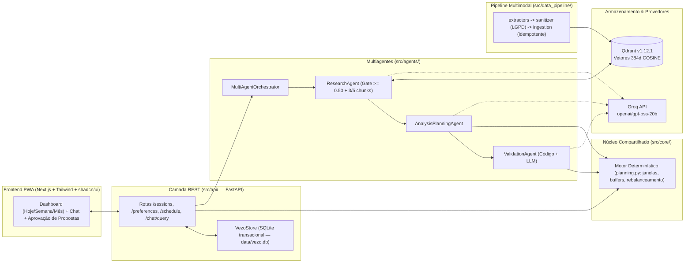
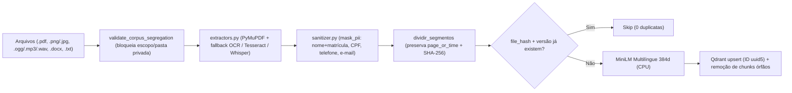
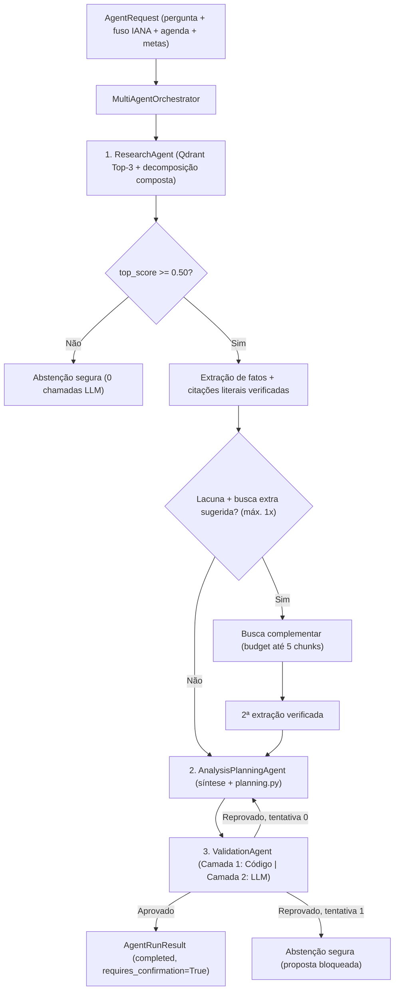
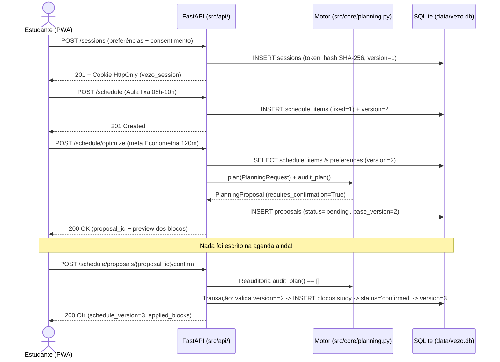

# Guia Didático da Arquitetura do Vezo — Onboarding da Equipe

> **Para quem é este guia:** colegas de Frontend (PWA), Backend, Produto e MLOps que vão integrar novas rotas, telas ou experimentos sobre o núcleo técnico do **Vezo** (`assistente-rotina-academica`).
> **Estado refletido:** núcleo técnico completo consolidado na branch `develop` (RAG idempotente/LGPD + Multiagentes + Motor Determinístico `src/core/` + API FastAPI/SQLite `src/api/`).
> **Marco de entrega do MVP:** `11/12/2026`.

---

## Sumário

1. [Visão Ponta a Ponta e Persistência Poliglota (Qdrant vs. SQLite)](#1-visão-ponta-a-ponta-e-persistência-poliglota-qdrant-vs-sqlite)
2. [Camada de Dados e RAG Idempotente com Guardrails LGPD](#2-camada-de-dados-e-rag-idempotente-com-guardrails-lgpd)
3. [Sistema Multiagentes e Contratos Pydantic v2](#3-sistema-multiagentes-e-contratos-pydantic-v2)
4. [Motor Determinístico Compartilhado (`src/core/planning.py`)](#4-motor-determinístico-compartilhado-srccoreplanningpy)
5. [API FastAPI, Sessões Seguras e Fluxo de Confirmação (`src/api/`)](#5-api-fastapi-sessões-seguras-e-fluxo-de-confirmação-srcapi)
6. [Guia Rápido para Rodar, Testar e Plugar o Frontend](#6-guia-rápido-para-rodar-testar-e-plugar-o-frontend)

---

## 1. Visão Ponta a Ponta e Persistência Poliglota (Qdrant vs. SQLite)

O **Vezo** resolve dois problemas complementares do universitário em multijornada:

1. **Responder regras e prazos espalhados em documentos heterogêneos** (PDFs de editais, fotos de grades horárias e relatos em áudio) **sem alucinar** e sempre citando a fonte literal.
2. **Organizar e reorganizar horários de estudo sem invadir sono nem compromissos fixos**, exigindo **confirmação humana explícita** (`requires_confirmation=True`) antes de gravar qualquer mudança.

Para atender esses dois mundos com rigor de engenharia, o backend separa claramente **inteligência semântica (RAG + LLM)** de **cálculo e estado transacional (Python determinístico + SQLite)**:



### Por que usamos Persistência Poliglota (Qdrant + SQLite)?

Uma dúvida comum de quem entra no projeto é: *"Por que manter dois bancos (Qdrant e SQLite) em vez de colocar tudo em um só?"*

A resposta é simples: **busca por significado** e **estado transacional de agenda** têm requisitos matemáticos opostos.

| Critério | Qdrant (`rotina_estudante_multimodal`) | SQLite (`data/vezo.db`) |
| :--- | :--- | :--- |
| **O que armazena** | Chunks de documentos (editais, grades OCR, áudios transcritos) + embeddings de 384 dimensões + metadados de citação. | Sessões (hash de token), preferências (fuso/sono/buffers), itens da agenda (`fixed` vs. `study`), propostas (`pending`/`confirmed`/`rejected`) e histórico de chat. |
| **Tipo de consulta** | **Similaridade aproximada (cosseno):** *"qual trecho fala sobre frequência e advertências?"* | **Consistência exata (ACID):** *"aplique esta proposta SOMENTE se a agenda ainda estiver na versão 4"*. |
| **Garantia principal** | Recuperação semântica rápida em português (`~50 ms`) com filtro por score (`>= 0.50`). | **Atomicidade e isolamento por sessão:** zero perda de compromissos fixos, controle otimista de versão (`base_version`) e chaves estrangeiras (`ON DELETE CASCADE`). |
| **Escopo dos dados** | **Corpus institucional/compartilhado** (sanitizado contra PII; dados privados são bloqueados). | **Dados operacionais privados da sessão** do estudante (nunca enviados para o índice vetorial compartilhado). |

> **Regra de ouro da arquitetura:** o Qdrant responde *"o que dizem os documentos?"*; o SQLite guarda *"qual é a agenda real confirmada deste estudante?"*. Os dois mundos nunca se misturam indevidamente.

---

## 2. Camada de Dados e RAG Idempotente com Guardrails LGPD

A camada `src/data_pipeline/` transforma arquivos brutos heterogêneos em vetores auditáveis no Qdrant sem duplicatas e sem vazamento de dados pessoais.



### Principais componentes (`src/data_pipeline/`)

1. **Extração multimodal com localizadores (`extractors.py`):**
   - **PDF (`extrair_paginas_pdf`):** lê texto digital via `PyMuPDF`; em páginas escaneadas sem camada de texto, renderiza em 2x e aplica Tesseract OCR (`lang="por"`, `--psm 6`), marcando cada segmento com `"p. 1"`, `"p. 2"`, etc.
   - **Áudio (`transcrever_audio_com_tempos`):** transcreve `.ogg`/`.mp3`/`.wav` via Whisper `tiny` em português (`fp16=False`), preservando faixas de tempo `"MM:SS-MM:SS"` agrupadas até o limite do chunk.
   - **Imagem (`extrair_texto_imagem`):** Tesseract OCR (`"imagem"`).
   - **Word/TXT:** `python-docx` (parágrafos + tabelas com `|`) e leitura UTF-8 com BOM (`"documento"`).

2. **Sanitização PII e segregação LGPD (`sanitizer.py`):**
   - `mask_pii(text)` aplica mascaramento determinístico antes da vetorização:
     - Nome acompanhado de matrícula/RA/RGA (inline ou multilinha) → `[NOME_REMOVIDO]` e `[MATRICULA_REMOVIDA]`
     - CPF (formatado ou rotulado) → `[CPF_REMOVIDO]`
     - E-mail → `[EMAIL_REMOVIDO]`
     - Telefone BR (com/sem DDD ou rotulado) → `[TELEFONE_REMOVIDO]`
     - Preserva integralmente regras acadêmicas (`90%`, `08h às 09h50`, `17/08/2026`, `R$ 1.500,00`).
   - `validate_corpus_segregation(...)` levanta `PermissionError` caso alguém tente indexar `corpus_scope="private"` ou arquivos em diretórios privados (`private/`, `privado/`, `pessoal/`) na coleção institucional compartilhada.

3. **Carga batch idempotente (`ingestion.py`, `INGESTION_VERSION = "2.0.0"`):**
   - **IDs determinísticos:** cada chunk recebe `uuid5(NAMESPACE_URL, f"{user_id}:{source}:{chunk_index}")`.
   - **Idempotência real:** por padrão (`recreate=False`), a coleção não é apagada. O pipeline calcula `file_hash` (SHA-256 do texto sanitizado) e compara com os pontos já existentes no Qdrant para aquele `source`:
     - Se `file_hash`, `ingestion_version` e contagem de chunks forem iguais → **skip** (0 duplicatas).
     - Se o arquivo mudou e encolheu → faz `upsert` nos novos chunks e **deleta os chunks órfãos** antigos.
   - **Sinalização de qualidade:** arquivos vazios falham explicitamente (nunca são indexados); textos muito curtos (`< 25` caracteres) recebem `quality_warning`.
   - **Contrato de payload no Qdrant (6 campos base preservados + 8 metadados de auditoria):**

```json
{
  "text": "O residente deve participar de, no mínimo, 90% das atividades formativas...",
  "source": "data/samples/edital_residencia_02.pdf",
  "task_type": "texto",
  "user_id": "usuario_teste",
  "created_at": "2026-11-21T15:42:00+00:00",
  "chunk_index": 21,
  "source_id": "edital_residencia_02",
  "title": "Edital Residencia 02",
  "page_or_time": "p. 5",
  "content_hash": "a3f1...9c02",
  "file_hash": "8d4b...11e7",
  "corpus_scope": "institutional",
  "ingestion_version": "2.0.0",
  "quality_warning": null
}
```

4. **Retrieval padronizado (`retrieval.py`):**
   - Usa exclusivamente `sentence-transformers/paraphrase-multilingual-MiniLM-L12-v2` (**384 dimensões**, distância **COSINE**) e `client.query_points(...)`.
   - Conecta ao servidor Docker quando `QDRANT_URL=http://localhost:6333` está definida, com fallback para disco local (`data/qdrant`).

---

## 3. Sistema Multiagentes e Contratos Pydantic v2

Em vez de um único prompt monolítico que "pesquisa, planeja e aprova a si mesmo", o Vezo separa responsabilidades em **3 agentes especializados** coordenados deterministicamente em Python (`src/agents/orchestrator.py`), todos trocando contratos **Pydantic v2** com `ConfigDict(extra="forbid", allow_inf_nan=False)`.



### Papel de cada agente e suas travas de segurança

| Componente | Arquivo | O que faz | Trava determinística em código |
| :--- | :--- | :--- | :--- |
| **`ResearchAgent`** | `src/agents/research_agent.py` | Valida a coleção Qdrant (vetor único 384d `COSINE`), decompõe perguntas compostas com duas orações interrogativas, aplica gate pré-LLM (`threshold=0.50`), extrai fatos e pode fazer **até 1 rodada de refinamento** (máx. 2 queries extras). | **Budget de 3 chunks** (pergunta simples) ou **5 chunks** (composta/refinamento). **Verificação literal:** todo `quote` extraído precisa existir literalmente no trecho (`normalize(quote) in normalize(chunk.text)`), descartando citações fabricadas. Se `top_score < 0.50` ou `verified_facts` vazio → abstém. |
| **`AnalysisPlanningAgent`** | `src/agents/analysis_planning_agent.py` | Gera `Claim`s curtos com `source_ids` existentes e aciona o motor Python `plan(request)` para metas de estudo. | O texto final é montado **por código** via `render_claims` no formato `[C1: edital_residencia_02.pdf]`. O LLM **nunca** calcula horários em prosa. |
| **`ValidationAgent`** | `src/agents/validation_agent.py` | Audita a resposta e a agenda proposta antes de liberar para o usuário. | **Camada 1 (sem LLM):** checa presença de `claims`, existência de `source_ids`, igualdade exata com `render_claims` e `audit_plan == []`. Qualquer erro reprova **sem chamar o LLM**. **Camada 2 (LLM):** audita fidelidade semântica contra os chunks. |
| **`MultiAgentOrchestrator`** | `src/agents/orchestrator.py` | Coordena `research → analysis → validation`, permite **no máximo 1 rodada de correção** (limite absoluto de **6 chamadas LLM**) e registra `trace` + `metrics`. | Sanitiza exceções: jamais serializa corpo HTTP, headers ou `GROQ_API_KEY`. Rejeição persistente vira `abstained` (nunca entrega proposta inválida). |
| **`GroqLLM`** | `src/agents/llm.py` | Cliente HTTP puro (`urllib.request`, sem SDK externo) para `openai/gpt-oss-20b` na Groq. | `temperature=0`, `seed=42`, `max_completion_tokens=2048`, `reasoning_effort="low"`, `include_reasoning=False`, `tool_choice="none"`, saída JSON estrita, `User-Agent` explícito e pacing configurável (`min_call_interval`). |

### Exemplo real validado ao vivo (budget de 5 chunks)

Para a pergunta composta *"Qual é a frequência mínima exigida na residência e o que acontece após três advertências?"* (executada ao vivo contra Qdrant Docker + Groq):

- **Consultas executadas:** pergunta inteira + 2 cláusulas decompostas + 1 refinamento (`"frequência mínima" residência programa`).
- **5 chunks selecionados:** `C1` (`edital_residencia_02.pdf[c27]`, `0.6798`) até `C5` (`edital_residencia_02.pdf[c33]`, `0.5194`).
- **Resposta auditada (`gaps: []`):**
  > O residente deve participar de, no mínimo, 90% das atividades formativas programadas para ocorrer presencialmente nas instalações do Programa. `[C4: edital_residencia_02.pdf]`
  > O residente que acumular 3 (três) advertências será desligado do Programa. `[C1: edital_residencia_02.pdf]`

---

## 4. Motor Determinístico Compartilhado (`src/core/planning.py`)

LLMs são ótimos para linguagem, mas péssimos em aritmética de datas, fusos horários e restrições rígidas. Por isso, **100% da matemática de agenda** foi isolada em `src/core/planning.py` + `src/core/schemas.py` — desacoplada dos agentes (com `src/agents/planning.py` atuando como fachada retrocompatível) e reutilizada diretamente tanto pelo `AnalysisPlanningAgent` quanto pela API FastAPI.

### Como funciona o cálculo de janelas e buffers

1. **Sono protegido no fuso IANA (`expand_sleep_slots`):** expande a janela recorrente (`sleep_start` → `sleep_end`, padrão `22:00`–`06:00`) no fuso da sessão (`ZoneInfo`), cobrindo virada de meia-noite e transições de horário de verão (DST).
2. **Buffers configuráveis (`TASK-F3-05`):**
   - `buffer_minutes` global (padrão `0`) em `PlanningRequest` / `AgentRequest` / `RebalanceRequest`: adiciona folga antes e depois de compromissos fixos (`work`, `class`, `commute`, `other`) **e** entre blocos de estudo consecutivos.
   - `buffer_before_minutes` e `buffer_after_minutes` por `ScheduleSlot`: permite buffers específicos (ex.: 20 min antes e 30 min depois de uma aula presencial); prevalece sempre `max(buffer_global, buffer_slot)`.
   - A fronteira exata do sono (`22h–06h`) não é distorcida pelo buffer global.
3. **Detector de janelas livres (`free_windows`):** subtrai sono + compromissos fixos expandidos pelos buffers do horizonte (`≤ 14 dias`), retornando os intervalos livres reais prontos para exibição no dashboard.
4. **Otimização determinística (`plan`):**
   - Ordena metas por `(deadline, -priority, goal_id)`.
   - Aloca blocos entre `min_block_minutes` e `max_block_minutes` (padrão `1` a `60` min), evitando fragmentos inválidos abaixo do mínimo.
   - O que não couber antes do prazo vai explicitamente para `unallocated` — **jamais reduzindo sono ou movendo compromissos fixos**.
   - Conflitos pré-existentes entre fixos são reportados em `input_conflicts` sem mover nenhum fixo.

### Rebalanceamento diante de imprevistos com mínima perturbação (`rebalance`)

Quando surge um imprevisto (`disruptions`), o motor não embaralha a semana inteira do estudante:

1. **Preserva o que não foi afetado (`diff.kept`):** blocos flexíveis já agendados que continuam válidos (sem conflitar com sono, fixos, imprevistos ou buffers) permanecem exatamente no mesmo horário.
2. **Realoca apenas os blocos atingidos:** calcula novas janelas livres descontando sono + fixos + imprevistos + blocos `kept` (com buffers) e tenta encaixar os minutos afetados antes do prazo.
3. **Produz diff explícito (`ScheduleDiff`) e justificativas (`reasons`):**
   - `kept`: blocos flexíveis preservados sem alteração.
   - `moved`: blocos deslocados 1-para-1 com `previous_start/end → new_start/end` e `reason`.
   - `removed` + `added`: blocos que precisaram ser fragmentados em janelas menores ou ficaram sem espaço.
   - `unallocated`: minutos sem encaixe viável (com justificativa declarando que sono e fixos foram preservados).
   - `requires_confirmation: true`: **sempre obrigatório**.
4. **Auditoria de invariantes (`audit_plan` e `audit_rebalance`):** validam em código zero invasões de sono/fixos/imprevistos/buffers, zero sobreposições, respeito ao horizonte/prazo, consistência exata do `diff` e soma `alocado + pendente == duration_minutes`.

#### Exemplo real de saída de `POST /schedule/reallocate`

```json
{
  "proposal_id": "prop-9a4e12bc7d01",
  "proposal_type": "reallocate",
  "status": "pending",
  "base_version": 3,
  "requires_confirmation": true,
  "rebalance": {
    "proposed_blocks": [
      {
        "goal_id": "econ",
        "title": "Estudo de Econometria",
        "start": "2026-11-17T16:00:00-03:00",
        "end": "2026-11-17T17:00:00-03:00"
      },
      {
        "goal_id": "econ",
        "title": "Estudo de Econometria",
        "start": "2026-11-17T17:15:00-03:00",
        "end": "2026-11-17T18:15:00-03:00"
      }
    ],
    "diff": {
      "kept": [
        {
          "goal_id": "econ",
          "title": "Estudo de Econometria",
          "start": "2026-11-17T16:00:00-03:00",
          "end": "2026-11-17T17:00:00-03:00"
        }
      ],
      "moved": [
        {
          "goal_id": "econ",
          "title": "Estudo de Econometria",
          "previous_start": "2026-11-17T14:00:00-03:00",
          "previous_end": "2026-11-17T15:00:00-03:00",
          "new_start": "2026-11-17T17:15:00-03:00",
          "new_end": "2026-11-17T18:15:00-03:00",
          "reason": "Imprevisto 'Reunião emergencial' conflitou com o horário original"
        }
      ],
      "added": [],
      "removed": []
    },
    "reasons": [
      "Imprevisto informado: Reunião extra convocada pelo cliente",
      "Bloco 'Estudo de Econometria' movido de 2026-11-17T14:00:00-03:00 para 2026-11-17T17:15:00-03:00 (Imprevisto 'Reunião emergencial' conflitou com o horário original).",
      "1 bloco(s) flexível(is) não afetado(s) preservado(s) sem alteração."
    ],
    "unallocated": [],
    "input_conflicts": [],
    "diff_summary": "1 mantidos, 1 movidos, 0 adicionados, 0 removidos; 0 objetivos com tempo pendente. Nenhuma agenda foi alterada.",
    "requires_confirmation": true
  }
}
```

---

## 5. API FastAPI, Sessões Seguras e Fluxo de Confirmação (`src/api/`)

A camada `src/api/` expõe todo o núcleo técnico em endpoints REST tipados com documentação interativa automática em `/docs` (Swagger UI) e `/openapi.json`.

### Modelo de Sessão Segura (MVP)

- `POST /sessions` gera um token criptográfico aleatório (`secrets.token_urlsafe(32)`), salva **apenas o hash SHA-256** em `sessions.token_hash` no SQLite e devolve:
  - Cookie `vezo_session` com `HttpOnly` e `SameSite=Lax` (ideal para o PWA no navegador);
  - `session_token` no JSON de criação para uso opcional via header `X-Session-Token` (ideal para Swagger, `curl` e testes automatizados).
- **Zero IDOR / acesso cruzado:** nenhuma rota recebe `session_id` manipulável na URL; toda consulta filtra pela sessão autenticada do token (`401` sem token válido, `404` se tentar acessar item/proposta de outra sessão).

### Mapa Completo de Endpoints

| Grupo | Método & Rota | Descrição | Principais Regras / Status |
| :--- | :--- | :--- | :--- |
| **Saúde** | `GET /health` | Status da API, SQLite, Qdrant e LLM. | `200 OK` (público). |
| **Sessões** | `POST /sessions` | Cria sessão persistente com preferências iniciais e consentimento LGPD. | `201 Created` + cookie `HttpOnly`. |
| **Sessões** | `GET /sessions/me` | Retorna resumo e `schedule_version` da sessão ativa. | `200 OK` / `401`. |
| **Preferências** | `GET /preferences` | Lê fuso IANA, janela de sono, buffers, limites de bloco e consentimento. | `200 OK` / `401`. |
| **Preferências** | `PUT` / `PATCH /preferences` | Atualiza preferências e incrementa `schedule_version`. | `200 OK` / `422` (fuso inválido ou sono igual). |
| **Agenda** | `GET /schedule` | Lista itens, `schedule_version`, `input_conflicts` e `free_windows` (quando `horizon_start`/`horizon_end` forem enviados). | `200 OK` / `401` / `422`. |
| **Agenda** | `POST /schedule` | Cria compromisso fixo (`fixed=true`) ou bloco flexível (`fixed=false`). | `201 Created`; **`409 Conflict`** se `kind="sleep"` ou invadir sono protegido. |
| **Agenda** | `PATCH /schedule/{item_id}` | Atualiza item flexível da sessão. | `200 OK`; **`409 Conflict`** em compromisso fixo/sono protegido; `404` se de outra sessão. |
| **Agenda** | `DELETE /schedule/{item_id}` | Remove item flexível da sessão. | `204 No Content`; **`409 Conflict`** em compromisso fixo/sono protegido. |
| **Planejamento** | `POST /schedule/optimize` | Chama `plan()` + `audit_plan()` e grava proposta `pending` com `base_version`. | `200 OK`; nunca altera `schedule_items`. |
| **Planejamento** | `POST /schedule/reallocate` | Chama `rebalance()` + `audit_rebalance()` sobre os blocos flexíveis do horizonte e grava proposta `pending`. | `200 OK`; nunca altera `schedule_items`. |
| **Confirmação** | `POST /schedule/proposals/{id}/confirm` | Reaudita invariantes, checa `base_version == schedule_version` e grava os blocos flexíveis em **transação atômica SQLite**. | `200 OK`; **`409 Conflict`** se já resolvida ou se a agenda mudou (versão defasada). |
| **Confirmação** | `POST /schedule/proposals/{id}/reject` | Marca proposta como `rejected` sem alterar a agenda. | `200 OK`; `409` se já resolvida. |
| **Chat** | `POST /chat/query` | Executa `MultiAgentOrchestrator` (assíncrono via threadpool), retorna resposta, citações tipadas, abstenção, `planning` e `proposal_id` pendente (quando houver). | `200 OK`; **`503`** sanitizado se Qdrant/Groq indisponíveis (nunca inventa resposta). |
| **Chat** | `GET /chat/history` | Retorna histórico persistido de mensagens e citações da sessão. | `200 OK`. |

### Fluxo Completo: Gerar Proposta → Revisar → Confirmar (com Controle de Versão)



> **Proteção contra condição de corrida (Optimistic Locking):** se o estudante gerar uma proposta na `version=2`, adicionar outra aula (`version=3`) e tentar confirmar a proposta antiga, a API retorna **`409 Conflict`** explicando que a agenda mudou — evitando aplicar blocos desatualizados sobre um compromisso novo.

---

## 6. Guia Rápido para Rodar, Testar e Plugar o Frontend

### 1. Subir a infraestrutura e a API localmente

```bash
# 1. Ativar ambiente Python 3.11 (.venv)
.\.venv\Scripts\Activate.ps1

# 2. Subir Qdrant (http://localhost:6333) e MLflow (http://localhost:5000)
docker compose -f infra/docker-compose.yml up -d

# 3. (Opcional) Ingerir/atualizar documentos de forma idempotente no Qdrant
$env:QDRANT_URL="http://localhost:6333"
python -m src.data_pipeline.ingestion

# 4. Subir a API FastAPI (Swagger disponível em http://localhost:8000/docs)
$env:QDRANT_URL="http://localhost:6333"
uvicorn src.api.main:app --reload --port 8000
```

### 2. Exemplo rápido de integração para o Frontend (Next.js / `fetch`)

```ts
const API_URL = process.env.NEXT_PUBLIC_API_URL ?? "http://localhost:8000";

// 1. Criar sessão (o navegador guarda automaticamente o cookie HttpOnly)
await fetch(`${API_URL}/sessions`, {
  method: "POST",
  credentials: "include",
  headers: { "Content-Type": "application/json" },
  body: JSON.stringify({
    timezone: "America/Sao_Paulo",
    sleep_start: "22:00:00",
    sleep_end: "06:00:00",
    buffer_minutes: 15,
    consent_accepted: true,
  }),
});

// 2. Consultar o assistente no chat (com citações e abstenção segura)
const chatRes = await fetch(`${API_URL}/chat/query`, {
  method: "POST",
  credentials: "include",
  headers: { "Content-Type": "application/json" },
  body: JSON.stringify({
    question: "Qual é a frequência mínima exigida na residência e o que acontece após três advertências?",
  }),
});
const chatData = await chatRes.json();
// chatData.abstained, chatData.answer, chatData.citations, chatData.proposal_id
```

> **CORS configurado por padrão:** `http://localhost:3000` e `http://127.0.0.1:3000` com `allow_credentials=True` (personalizável via `VEZO_CORS_ORIGINS`).

### 3. Comandos de verificação antes de abrir PR

```bash
# Lint e formatação
ruff check .
ruff format --check .

# Tipagem estática
mypy src --ignore-missing-imports --no-warn-return-any

# Gate completo pré-CI (Guardrails LGPD + Ruff + MyPy + Pytest)
python .agents/skills/pr-review/scripts/check_pr.py --base develop

# Suíte completa local (117+ testes offline)
pytest tests/test_smoke.py tests/test_benchmark_golden_set.py tests/test_zero_shot.py tests/test_guardrail_rag.py tests/test_retrieval.py tests/test_planning_core.py tests/test_multiagents.py tests/test_api.py -v
```

---

### Mapa de Arquivos do Núcleo Técnico

| Camada | Arquivos principais | Responsabilidade |
| :--- | :--- | :--- |
| **Dados & RAG** | `src/data_pipeline/extractors.py`, `sanitizer.py`, `ingestion.py`, `retrieval.py` | Extração multimodal, mascaramento PII, segregação LGPD, ingestão idempotente e busca 384d `COSINE`. |
| **Núcleo de Agenda** | `src/core/schemas.py`, `src/core/planning.py` | Contratos de agenda, janelas livres, buffers, otimização, rebalanceamento com diff e auditorias. |
| **Multiagentes** | `src/agents/schemas.py`, `llm.py`, `research_agent.py`, `analysis_planning_agent.py`, `validation_agent.py`, `orchestrator.py`, `planning.py` | Orquestração dos 3 agentes, orçamento 3/5 chunks, verificação literal de citações e cliente Groq nativo. |
| **Backend API** | `src/api/main.py`, `storage.py`, `dependencies.py`, `schemas.py` | Rotas FastAPI, sessões `HttpOnly`/`X-Session-Token`, SQLite transacional e confirmação otimista. |
| **Testes** | `tests/test_retrieval.py`, `test_planning_core.py`, `test_multiagents.py`, `test_api.py` | Validação automatizada de ingestão/PII, anti-alucinação, invariantes do motor e contratos REST. |
