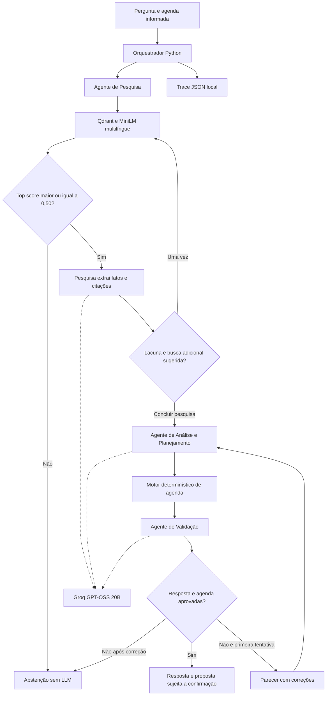

# Sistema multiagentes do Vezo

Implementação v1 da proposta consolidada fornecida em 16/11/2026, para a entrega
prevista em 20/11. Reaproveita o retrieval da Sprint 2 e a integração HTTP Groq da
Sprint 3. São três papéis com instruções e respostas estruturadas independentes,
coordenados por Python. Não requer treinamento ou um modelo diferente por agente.

## Arquitetura e colaboração

O refinamento retorna à busca uma única vez e mantém o gate inicial já aplicado;
o diagrama representa a conexão lógica, não um ciclo ilimitado. Todas as decisões,
evidências, rodadas de pesquisa e pedidos de correção ficam no trace. Não são
armazenadas cadeias internas de raciocínio do modelo.

| Componente | Responsabilidade | Saída |
|---|---|---|
| ResearchAgent | Buscar, aplicar gate, extrair fatos com citações literais, registrar lacunas e propor até duas buscas complementares em uma rodada | RetrievalResult |
| AnalysisPlanningAgent | Sintetizar afirmações com IDs de evidência e acionar o motor Python para metas explícitas | ProposalDraft |
| ValidationAgent | Auditar semanticamente as afirmações e limitações; executar verificações de citação e agenda | ValidationResult |
| MultiAgentOrchestrator | Encaminhar resultados, permitir uma correção, interromper falhas e registrar métricas | AgentRunResult |
| Motor de agenda | Subtrair sono e compromissos fixos, distribuir minutos antes dos prazos | PlanningProposal |

A pesquisa usa `src/data_pipeline/retrieval.py`, sem executar os scripts completos
de benchmark. Preserva o gate de similaridade do guardrail existente, evitando
importar scripts com efeitos globais e uma geração adicional não auditada.

## Contratos e decisões

`src/agents/schemas.py` define os contratos Pydantic, com proibição de campos
inesperados. Não modifica o schema do benchmark da Sprint 3.

- AgentRequest: run_id, question, timezone IANA, schedule_slots, study_goals,
  horizon e horários de sono (padrão 22h–06h).
- RetrievalResult: consultas realizadas, rounds de pesquisa, top_score, até três
  chunks finais, citações, fatos extraídos, lacunas e decisão de abstenção.
- ProposalDraft: afirmações com source_ids, texto renderizado, limitações e plano.
- PlanningProposal: blocos sugeridos, minutos não alocados, resumo e
  requires_confirmation=true.
- ValidationResult: valid, factual_ok, invariants_ok, violações, correções e tentativa.
- AgentRunResult: request, modo live/simulated, configurações, saídas dos agentes,
  final_answer, trace, métricas e erro sanitizado.

O campo `verified_facts` significa que a citação literal foi encontrada no trecho;
isso não comprova automaticamente que a paráfrase é correta. A auditoria semântica
é uma etapa posterior, sujeita também a erros do LLM.

Cada afirmação final é renderizada com `[C1: arquivo.pdf]`. IDs inexistentes e texto
que divirja das afirmações estruturadas são reprovados por código. A existência
da citação não basta: o validador LLM compara o significado com o trecho original.

Perguntas com duas orações interrogativas podem gerar três buscas iniciais
(pergunta inteira e duas partes). A extração pode solicitar até duas buscas curtas
adicionais em uma única rodada. Cada consulta usa o mesmo retrieval Top-3; a união
é deduplicada e limitada a três chunks finais, preservando cobertura entre buscas.
Esse mecanismo muda o perfil de retrieval em relação ao benchmark da Sprint 3:
não comparar métricas diretamente sem controlar essa diferença.

Se o melhor score inicial for ausente ou menor que 0,50, não há chamada ao LLM.
Uma consulta permitida usa normalmente três chamadas; o refinamento pode acrescentar
uma e a correção pode acrescentar duas: limite de seis chamadas por fluxo. A
validação determinística pode reprovar antes de chamar o LLM. Não há retry HTTP
oculto. Erros ou rejeição persistente não liberam a proposta ao estudante.

## Planejamento e restrições

O motor recebe datas absolutas com fuso, horizonte de até 14 dias, metas com
minutos de estudo, prazo e prioridade. Não transforma “semana que vem” em prazo
nem interpreta compromissos livres automaticamente. Esses dados precisam ser
informados em AgentRequest; não são inventados ou persistidos pelo modelo.

Sono recorrente é expandido no fuso informado. Compromissos sobrepostos são unidos
na subtração das janelas ocupadas. Metas são ordenadas por prazo, prioridade
(decrescente) e ID. Os blocos têm até 60 minutos; intervalos podem gerar blocos
menores, com granularidade de um minuto. Minutos sem espaço aparecem em unallocated.

A auditoria verifica horizonte, prazo, objetivo, duração, contabilização de
pendências, sono, compromissos fixos e sobreposição entre blocos. O LLM não pode
anular uma reprovação dessas regras. A agenda original permanece intacta.

O exemplo inclui um conflito já existente entre CLT e aula na terça/quinta.
O sistema o informa e não move esses compromissos. Uma proposta de estudo sem
novos conflitos não resolve automaticamente os conflitos originais.

Nesta versão, aulas e deslocamentos precisam estar na agenda estruturada para
serem protegidos. Uma menção em documento não é convertida silenciosamente em
compromisso recorrente. Confirmar o perfil correto e incorporar regras extraídas
à agenda é uma evolução que requer mapeamento e confirmação explícitos.

## Segurança e limites

Documentos, perguntas e pareceres são tratados como dados não confiáveis nos
prompts. O cliente não fornece ferramentas de execução ao LLM. Essa defesa reduz
risco de prompt injection, mas não constitui garantia contra todos os ataques.

O servidor Qdrant é verificado para vetor único, 384 dimensões e COSINE. Dimensão
correta não comprova o encoder de origem: a coleção precisa ter sido criada com o
mesmo MiniLM multilíngue documentado. Não é reindexada nem apagada pela demonstração.

Traces incluem trechos documentais e agenda informada. Permanecem locais em
reports/multiagents (ignorado pelo Git); revisão de privacidade é necessária antes
de compartilhar. Nenhuma chave é incluída no trace ou mensagens de erro.

Um score alto não garante resposta, e 0,50 é limiar experimental. O validador pode
errar; a amostra de demonstração não comprova precisão geral nem elimina alucinações.
Não há PWA, sessões persistentes, escrita de agenda, envio ao Teams ou exportação ICS.

Os três papéis usam o mesmo modelo e podem compartilhar vieses ou erros. Separar
instruções e rodadas de validação não equivale a uma avaliação independente por
humanos ou modelos diferentes. As verificações determinísticas são complementares.
