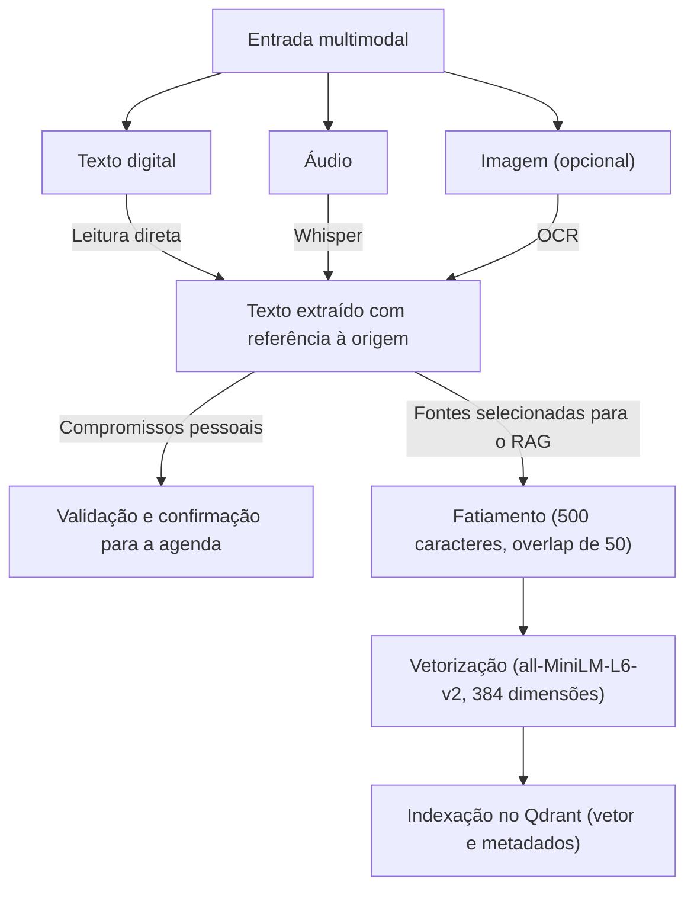

# Arquitetura do pipeline de dados do Assistente Pessoal Universitário

| Campo | Registro |
| --- | --- |
| Frente | F4 · Backend e Engenharia de Software |
| Responsável principal | Mahiaara |
| Par de revisão | Hazel |
| Status | Proposta técnica para o MVP · revisão pendente |
| Data | 07/11/2026 |

## 1. Escopo

O Assistente Pessoal Universitário apoia estudantes universitários que conciliam estudo, trabalho e outras responsabilidades. O pacote de definição prevê dois usos distintos dos dados. O **motor de planejamento** calcula disponibilidade e conflitos a partir de compromissos estruturados. O **RAG** recupera passagens de fontes de referência para fundamentar as explicações das alternativas de planejamento. O primeiro depende de campos como prazo, duração, prioridade e horários fixos. O segundo precisa recuperar evidências e identificar suas fontes. *Pacote de definição do projeto, pp. 5–6 e 9*

A arquitetura abaixo é uma proposta baseada no pacote de definição e na tarefa da F4. O cronograma prevê um RAG textual na semana 2 e áudio na semana 5. O OCR atende à importação opcional de imagens. Compromissos pessoais extraídos de texto, áudio ou imagem alimentam o fluxo privado de agenda após validação e confirmação do estudante. A coleção de evidências é alimentada por fontes selecionadas para o RAG. *Pacote de definição do projeto, RF01–RF04, RF08–RF11, RNF10 e cronograma*

## 2. Pipeline de ingestão e indexação

Na ramificação do RAG, cada ponto no Qdrant associa o vetor ao trecho recuperável e à sua procedência. O metadado deve incluir identificador do documento e do trecho, título, versão, origem e data da fonte. Quando disponível, registre também página, seção ou intervalo de tempo. Na consulta, a pergunta é vetorizada com a mesma versão do modelo e comparada aos trechos por similaridade de cosseno. O gerador recebe os trechos recuperados com as referências e sinaliza quando eles são insuficientes para sustentar uma orientação. *Pacote de definição do projeto, RF08, RF09, RNF05 e RNF11* · [Qdrant, Collections][qdrant]

## 3. Fatiamento de 500 caracteres com 50 de sobreposição

**Decisão.** Usar até **500 caracteres por trecho**, com sobreposição nominal de **50 caracteres** entre trechos consecutivos da mesma unidade textual quando ela precisar ser dividida. Em uma janela fixa, o overlap corresponde a 10% do trecho e o avanço é de 450 caracteres. Ao ajustar os cortes a limites naturais do texto, o avanço efetivo pode variar.

**Justificativa.** A unidade de informação de um compromisso acadêmico é o próprio evento, com campos que precisam ser interpretados juntos. Por exemplo, em “Entrega do relatório de Redes até sexta-feira, às 23h59”, separar o horário da atividade prejudica a interpretação do prazo. A granularidade de 500 caracteres favorece trechos curtos e reduz a mistura de compromissos distintos. Na agenda, essa unidade corresponde a um registro estruturado. Nas fontes textuais do RAG, a mesma lógica favorece manter juntas uma orientação e suas condições. A sobreposição recupera parte do contexto junto ao corte, como um complemento de frase ou uma ressalva em uma diretriz. Ela também repete conteúdo, o que pode ocupar posições entre os primeiros resultados.

**Regras propostas.** Preservar entradas de lista, linhas de tabelas ou parágrafos curtos que já sejam unidades completas. Quando uma unidade ultrapassar o limite, priorizar cortes em fim de frase ou entre palavras e aplicar a sobreposição dentro da unidade. Preservar títulos e identificadores como metadados para que o trecho mantenha sua origem. Contar os tokens com o tokenizador do modelo antes da vetorização e subdividir trechos que excedam seu limite. O MiniLM trunca por padrão entradas acima de 256 *wordpieces*, e textos ruidosos de OCR ou com identificadores podem consumir mais tokens por caractere. [Ficha técnica do MiniLM][minilm]

Os valores de 500 e 50 são parâmetros iniciais. A verificação deve medir se o trecho recuperado preserva a informação necessária para responder à consulta e se a sobreposição introduz duplicatas nos cinco primeiros resultados.

## 4. Modelo de embeddings e comparação com 768 dimensões

**Decisão.** Adotar `sentence-transformers/all-MiniLM-L6-v2` como linha de base do MVP. O modelo produz vetores de 384 dimensões e foi concebido para frases e parágrafos curtos. A alternativa de referência é o `sentence-transformers/all-mpnet-base-v2`, com 768 dimensões. [Ficha técnica do MiniLM][minilm] · [Ficha técnica do MPNet][mpnet]

| Critério | all-MiniLM-L6-v2 | all-mpnet-base-v2 |
| --- | ---: | ---: |
| Dimensões do vetor | 384 | 768 |
| Espaço bruto por vetor em `float32` | 1.536 bytes | 3.072 bytes |
| MTEB original · recuperação, nDCG@10 em 15 conjuntos | 41,95 | 43,81 |
| MTEB original · média em 56 conjuntos | 56,26 | 57,78 |

Os resultados são da Tabela 1 do artigo original do MTEB. A métrica nDCG@10 considera a relevância dos resultados e suas posições entre os dez primeiros. O MPNet supera o MiniLM em 1,86 ponto na recuperação e em 1,52 ponto na média geral, na escala de 0 a 100 da tabela. Para o Assistente Pessoal Universitário, a métrica de recuperação é a comparação externa mais direta. O idioma, o corpus e a métrica de aceite do projeto exigem validação própria. [Muennighoff et al., 2023, seção 3.2 e Tabela 1][mteb]

**Latência e memória.** A documentação do Sentence Transformers relata que o MiniLM é cerca de cinco vezes mais rápido que o MPNet na comparação publicada. Essa referência sustenta a hipótese de menor latência de codificação, a medir no ambiente do Assistente Pessoal Universitário. Com a mesma quantidade de pontos e precisão, 384 dimensões reduzem pela metade o espaço bruto dos vetores. A memória efetiva também depende dos pesos do modelo, do índice, dos metadados, do tamanho dos lotes e da configuração de armazenamento. A dimensão sozinha tampouco determina o tempo de inferência ou a qualidade da recuperação. [Sentence Transformers, Pretrained Models][st] · [Qdrant, Collections][qdrant]

**Português e migração.** A ficha do MiniLM identifica o modelo como voltado ao inglês. A escolha para o MVP depende do desempenho em consultas em português e em consultas em português sobre fontes em inglês, quando esse cruzamento existir no corpus. Se a recuperação ficar aquém da meta, incluir uma referência multilíngue de 768 dimensões, como `intfloat/multilingual-e5-base`, no mesmo teste local. Trocar o modelo requer gerar novos embeddings para todo o corpus e consultar a coleção com o mesmo modelo usado na sua indexação. [Ficha técnica do MiniLM][minilm] · [Ficha técnica do E5 multilíngue][e5] · [Qdrant, Collections][qdrant]

## 5. Base de conhecimento para RAG e dados supervisionados

| Aspecto | Base de conhecimento do RAG | Dataset supervisionado |
| --- | --- | --- |
| Finalidade | Fornecer evidências recuperáveis durante a geração. | Ensinar uma relação entre entradas e alvos e medir a capacidade de generalização. |
| Unidade de dados | Fonte versionada, dividida em passagens com referência à origem. | Exemplo com entrada e rótulo ou valor-alvo, como uma agenda anotada com os conflitos esperados. |
| Uso no Assistente Pessoal Universitário | Indexar artigos e diretrizes selecionados e recuperar as passagens relevantes em cada consulta. | Treinar um componente supervisionado, caso venha a existir. Casos anotados também podem servir apenas à avaliação do motor. |
| Atualização | Revisar a fonte e atualizar os trechos afetados no índice. | Atualizar os exemplos e, para incorporar o aprendizado ao modelo, executar novo treinamento ou ajuste. |

No desenho proposto, o RAG fornece ao gerador contexto obtido de um índice externo durante a consulta, com os pesos dos modelos fixos. Um conjunto de perguntas com passagens esperadas pode avaliar o recuperador. Essas anotações pertencem ao protocolo de avaliação, enquanto as passagens de referência continuam disponíveis no índice. O pacote prevê casos sintéticos de agenda e documentos científicos indexados como entregas distintas da semana 2. [Lewis et al., 2020][rag] · *Pacote de definição do projeto, cronograma*

## 6. Validação e revisão

1. **Isolar o efeito do fatiamento.** Comparar 500/50 com 500/0 para medir o efeito do overlap e com 750/75 para avaliar uma janela maior com a mesma proporção de sobreposição. Usar o mesmo corpus, consultas e modelo, respeitando o limite de tokens em todas as configurações. Anotar evidências por documento e intervalo de texto, de modo que o gabarito permaneça válido quando os limites dos trechos mudarem.
2. **Medir recuperação e custo.** Comparar MiniLM e MPNet com os mesmos trechos, consultas, hardware, tamanho de lote e critério de avaliação. Registrar a fração de consultas com pelo menos uma passagem relevante entre as cinco primeiras, chamada **Recall@5** no pacote e equivalente a *Hit@5* nessa definição, com meta de **85% ou mais**. Registrar também nDCG@10, latência p50 e p95 de vetorização e busca, pico de RAM e tamanho do índice. Separar consultas em português sobre fontes em português e em inglês quando houver exemplos de ambos os tipos. *Pacote de definição do projeto, p. 9*
3. **Verificar o fluxo.** Conferir que texto digital, áudio transcrito e, quando habilitado, imagem processada mantêm sua procedência. Incluir casos em que o corte possa separar a atividade do prazo e casos em que trechos vizinhos disputem as primeiras posições da busca.
4. **Registrar a revisão de Hazel.** Conferir as justificativas, as fontes, as métricas e a leitura do diagrama. Registrar o parecer e a data na versão efetivamente revisada.

| Revisora | Situação | Data | Evidência da aprovação |
| --- | --- | --- | --- |
| Hazel | Pendente | A registrar | A registrar |

## Referências

- Grupo 2. *Pacote de definição do projeto*. Requisitos, métricas e cronograma.
- Muennighoff, N. et al. (2023). [MTEB: Massive Text Embedding Benchmark][mteb].
- Sentence Transformers. [Ficha técnica do all-MiniLM-L6-v2][minilm], [ficha técnica do all-mpnet-base-v2][mpnet] e [comparação de modelos pré-treinados][st].
- Intfloat. [Ficha técnica do multilingual-e5-base][e5].
- Qdrant. [Collections][qdrant].
- Lewis, P. et al. (2020). [Retrieval-Augmented Generation for Knowledge-Intensive NLP Tasks][rag].

[mteb]: https://aclanthology.org/2023.eacl-main.148.pdf
[minilm]: https://huggingface.co/sentence-transformers/all-MiniLM-L6-v2
[mpnet]: https://huggingface.co/sentence-transformers/all-mpnet-base-v2
[st]: https://www.sbert.net/docs/sentence_transformer/pretrained_models.html
[e5]: https://huggingface.co/intfloat/multilingual-e5-base
[qdrant]: https://qdrant.tech/documentation/manage-data/collections/
[rag]: https://arxiv.org/abs/2005.11401
